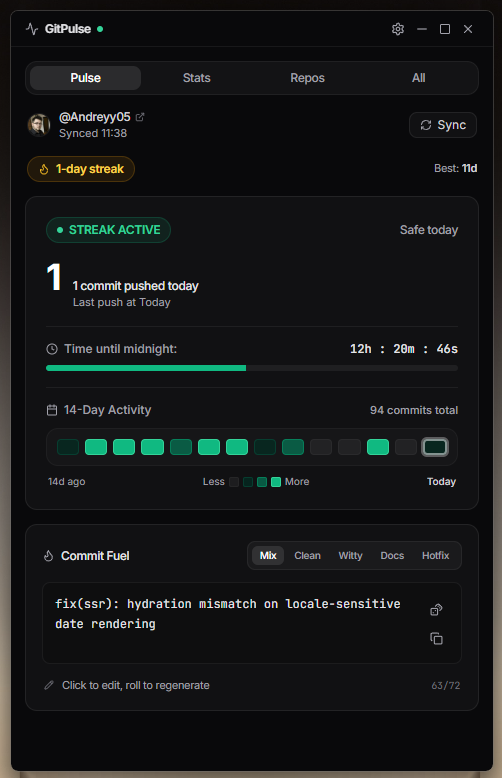
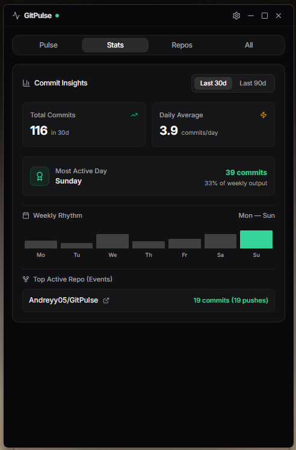
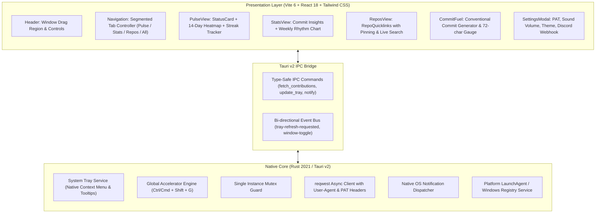

# ⚡ GitPulse

<div align="center">
  <p><strong>High-performance, lightweight native GitHub streak monitor and commit fuel companion</strong></p>
  <p>Engineered with system-level precision using <strong>Tauri v2</strong>, <strong>Rust 2021</strong>, <strong>React 18</strong>, and <strong>Tailwind CSS</strong>.</p>

  <br />

  [](https://apple.com/macos)
  [](https://microsoft.com/windows)
  [](https://rust-lang.org/)
  [](https://v2.tauri.app/)
  [](https://react.dev/)
  [](https://tailwindcss.com/)
  [](LICENSE)

  <br /><br />

  <table align="center">
    <tr>
      <td align="center"><strong>Pulse & Streak View</strong></td>
      <td align="center"><strong>Extended Commit Insights</strong></td>
    </tr>
    <tr>
      <td align="center">
        
      </td>
      <td align="center">
        
      </td>
    </tr>
  </table>

  <p><em>Frameless floating widget with native vibrancy, real-time streak telemetry, 14-day contribution heatmap, and deep developer analytics.</em></p>
</div>

---

## 📋 Overview

**GitPulse** is an engineering-focused personal developer companion built to track daily GitHub activity, safeguard contribution streaks, and spark momentum with intelligent commit message generation.

Unlike conventional Electron-based desktop utilities that consume hundreds of megabytes of RAM and run multiple background Chromium helper processes, GitPulse is engineered from the ground up on **Tauri v2** and **Rust**. By utilizing the operating system's native webview (WebKit on macOS, WebView2 on Windows), GitPulse delivers instant sub-200ms cold startups, ultra-low memory consumption (~30 MB RSS), and seamless integration into the system tray and global shortcut bus.

---

## ⚡ Technical Benchmarks

| Metric | Legacy Electron Stack | GitPulse (Tauri v2 + Rust) | Architectural Advantage |
| :--- | :--- | :--- | :--- |
| **Runtime Architecture** | Bundled Chromium + Node.js | Native OS Webview + Rust Core | Eliminates 150MB+ browser overhead |
| **Idle Memory (RSS)** | ~180 MB – 260 MB | **~30 MB – 45 MB** | **~80% lower RAM footprint** |
| **Cold Startup Time** | ~2,500 – 3,500 ms | **< 200 ms** | **12x faster execution** |
| **Background Processes** | 4 – 6 heavy child processes | **1 native binary + webview** | Minimal OS thread impact |
| **Installer / Binary Size**| ~140 MB | **~12 MB – 27 MB** | **>80% lighter distribution** |
| **Energy Impact** | High idle CPU wakeups | **Zero wakeups when idle** | Optimized for laptop battery life |

---

## 📊 Key Capabilities

### ⏱️ Streak & Deadline Telemetry (Pulse View)
* **Real-Time Streak Tracking**: Live consecutive day counter with automatic tracking of your all-time personal best record (`🔥 1-day streak · Best: 11d`).
* **Midnight Countdown Engine**: High-precision countdown timer calculating exact hours, minutes, and seconds until local midnight deadline with progress visualization.
* **Emergency Push Alert**: Visual pulse and audible warnings when less than 30 minutes remain before midnight without detected public commits.
* **Celebration Audio & Confetti**: Automatic celebratory chime and particle explosion upon detecting your first commit of the day.

### 🟩 14-Day Contribution Heatmap
* **Contribution Density Matrix**: Visual representation of the last 14 days of activity mapped against GitHub's official color levels (0 to 3+ commits).
* **Interactive Inspection**: Hover tooltips display exact commit quantities and formatted dates for each day.
* **Dynamic Highlight Ring**: Visual highlight distinguishing the current calendar day in real time.

### 📈 Extended Commit Insights (Stats View)
* **Flexible Analysis Windows**: Toggle between **Last 30 Days** and **Last 90 Days** activity windows.
* **Velocity Metrics**: Total commit output paired with daily throughput averages (`commits/day`).
* **Peak Output Detection**: Identifies your most productive weekday along with its percentage share of total output.
* **Weekly Rhythm Bar Chart**: Mon-through-Sun breakdown visualizing development cadence throughout the week.
* **Top Repository Ranking**: Ranked list of repositories driving the highest commit and push event volume.

### 📌 Repository Quicklinks (Repos View)
* **Integrated Repository Hub**: Instant access to your personal repositories without navigating to github.com.
* **Live Search Filter**: Real-time filtering by repository name, language, or topic tags.
* **Custom Pinning**: Pin your critical active projects to the top of the interface for one-click access.

### ✍️ Commit Fuel & Conventional Commits
* **Multi-Category Generator**: Curated Conventional Commit templates categorized by intent:
  * `Mix`: General developmental milestones.
  * `Clean`: Strict Conventional Commits (`feat:`, `fix:`, `refactor:`, `perf:`).
  * `Witty`: Humorous, relatable dev quips for non-critical side projects.
  * `Docs`: Documentation and markdown maintenance.
  * `Hotfix`: Critical patch declarations and emergency bugfixes.
* **In-Place Editable Buffer**: Click directly into the message box to adapt, edit, or append commit context before copying.
* **72-Character Length Gauge**: Live character counter with visual warning when commit headers exceed the standard 72-character Git recommendation.

### 📡 Offline Mode & Network Resilience
* **Zero Downtime Local Cache**: Activity state and repository listings are cached in local storage for instantaneous offline rendering.
* **Auto-Reconnection Synchronization**: Automatically detects network restoration (`window.addEventListener('online')`) and synchronizes with GitHub API in the background.

### 🖥️ Responsive Widescreen & Fullscreen HUD
* **Adaptive Widget Layout**: Functions as a compact, floating HUD widget (380×570 px) or scales dynamically into an executive dashboard on 1080p, 1440p, or 4K widescreen displays with larger heatmaps and typography.

---

## 🏗️ Architectural Design



---

## ⌨️ Controls & Global Shortcuts

| Action | macOS | Windows / Linux |
| :--- | :--- | :--- |
| **Toggle Window Visibility** | `Cmd + Shift + G` | `Ctrl + Shift + G` |
| **Move Window** | Click & drag titlebar | Click & drag titlebar |
| **Maximize / Restore** | Double-click titlebar | Double-click titlebar or maximize button |
| **Hide to Tray** | Traffic light close button (`✕`) | Titlebar close button (`✕`) |
| **Restore from Tray** | Click menu bar icon | Left-click notification area icon |
| **Force Activity Refresh** | Right-click tray -> *Refresh Activity Now* | Right-click tray -> *Refresh Activity Now* |
| **Quit Application** | Right-click tray -> *Quit GitPulse* | Right-click tray -> *Quit GitPulse* |

---

## 🛠️ Prerequisites & Installation

### Requirements
* **Node.js**: `v18.0.0` or higher (LTS recommended)
* **Rust**: `1.78+` (install via [rustup.rs](https://rustup.rs/))
* **Platform Dependencies**:
  * **Windows**: Visual Studio C++ Build Tools & Microsoft Edge WebView2 (standard on Windows 10/11).
  * **macOS**: Xcode Command Line Tools (`xcode-select --install`).

### Installation

Clone the repository and install frontend dependencies:

```bash
git clone https://github.com/Andreyy05/GitPulse_Rust.git
cd GitPulse_Rust
npm install
```

### Development Mode

Run the application with hot-module reloading and live Rust compilation:

```bash
npm run dev
# or: npx tauri dev
```

### Production Release Build

To build the standalone release binary and native installer:

```bash
npm run build
# or: npx tauri build
```

Generated production artifacts:
* **Windows**:
  * Standalone binary: `src-tauri/target/release/gitpulse.exe`
  * MSI Installer: `src-tauri/target/release/bundle/msi/GitPulse_1.0.0_x64_en-US.msi`
* **macOS**:
  * Standalone app: `src-tauri/target/release/bundle/macos/GitPulse.app`
  * DMG Installer: `src-tauri/target/release/bundle/dmg/GitPulse_1.0.0_x64.dmg`

---

## ⚙️ Configuration & Security

All configurations are stored locally via `localStorage` with zero telemetry:

* **GitHub Username**: Target GitHub account handle to monitor public events and contribution graphs.
* **Personal Access Token (PAT)**: Optional GitHub PAT (`read:user`, `repo`) to enable private repository commit tracking and raise API rate limits from 60 to 5,000 requests/hour.
* **Auto-Refresh Cadence**: Configurable polling interval (15, 30, or 60 minutes).
* **Audible Alerts & Volume**: Toggle sound effects (streak celebration, emergency warning) with dedicated volume slider.
* **Scheduled Evening Alert**: Daily reminder at a user-defined time (default `18:00`) if no commits have been pushed.
* **Discord Webhook**: Optional integration to relay streak alerts directly into your private Discord channel.
* **Launch at Startup**: Configurable system autostart integration.
* **Appearance Themes**: Toggle between **Dark**, **Light**, or **System** theme matching.

---

## 📄 License

Distributed under the MIT License. See [LICENSE](LICENSE) for more information.

<div align="center">
  Author: <b>Andrej Pavliščak</b> (<a href="https://github.com/Andreyy05">@Andreyy05</a>)
</div>
