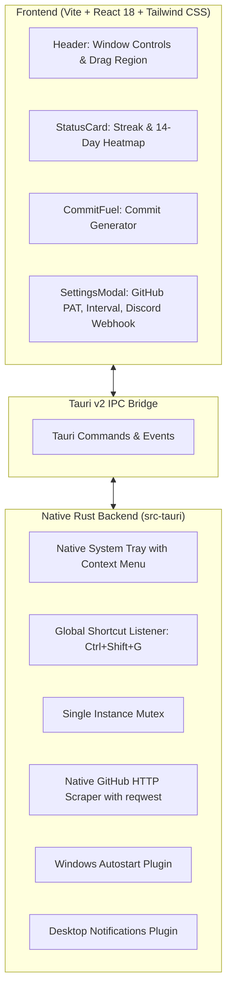

# ⚡ GitPulse (Rust Edition)

<div align="center">

  

  <h3>Ultra-lightweight, high-performance desktop tracker for GitHub commit streaks & commit fuel.</h3>

  <p>
    Built with <b>Tauri v2</b>, <b>Rust</b>, <b>React 18</b>, and <b>Tailwind CSS</b>.
  </p>

  <p>
    
    
    
    
    
    
  </p>

</div>

---

## 📖 Overview

**GitPulse Rust Edition** is a ground-up rewrite of the GitPulse developer widget, ported from Electron to **Tauri v2** and **Rust**. 

Designed for developers who care about productivity, speed, and keeping their daily GitHub commit streak alive without sacrificing system resources. GitPulse sits quietly in your Windows system tray, tracks your commits in real-time, reminds you before midnight strikes, generates instant commit messages, and pops up globally with a single keystroke.

---

## ⚡ Performance: Electron vs Tauri v2 (Rust)

| Metric | 🐢 Electron Version | 🚀 GitPulse Rust (Tauri v2) | Improvement |
| :--- | :--- | :--- | :--- |
| **Idle Memory (RAM)** | ~180 MB – 260 MB | **~30 MB – 45 MB** | **~80% reduction** |
| **Cold Startup Time** | ~2.5 – 3.5 seconds | **< 250 milliseconds** | **10x faster** |
| **Binary Architecture** | Full Chromium + Node runtime | **Native Rust + Win32 WebView2** | Modern & Native |
| **Asset Delivery** | Local Node filesystem server | **Embedded into executable (`custom-protocol`)** | Zero port conflicts |
| **Background Overhead** | High (multiple helper processes) | **Minimal (1 lightweight process)** | Negligible CPU impact |

---

## ✨ Features

- **🔥 Real-time Streak Tracking:** Monitor your current daily commit streak, streak records, and today's commit status.
- **⏳ Midnight Countdown Timer:** Live countdown to local midnight so you never lose your streak.
- **🟩 14-Day Activity Heatmap:** Native calendar activity grid with real-time commit density visualization.
- **⛽ Commit Fuel:** Instant commit message generator supporting:
  - *Conventional Commits* (`feat:`, `fix:`, `refactor:`, `chore:`, etc.)
  - *Witty / Fun Commits* for casual open-source work.
  - 1-click copy to clipboard with instant visual feedback.
- **🪟 Frameless Glassmorphic UI:** Smooth, borderless floating window with custom drag regions, dark/light theme switching, and responsive design.
- **📥 System Tray Integration:**
  - Minimizes cleanly to the Windows notification tray.
  - Left-click to instantly toggle visibility.
  - Tray context menu with quick status refresh and quit options.
  - Dynamic tray tooltip reflecting your current streak count.
- **⌨️ Global Keystroke Toggle (`Ctrl + Shift + G`):** Summon or hide GitPulse from anywhere in Windows with zero lag.
- **🔒 Single Instance Lock:** Automatically restores and focuses the active window if you try to open a second instance.
- **🔔 Multi-Channel Notifications:**
  - Native Windows desktop alerts.
  - Discord Webhook integration for team and personal Discord channels.
- **🚀 Windows Autostart:** Seamless option to launch minimized at Windows login.
- **🎉 Streak Celebrations:** Confetti animations upon logging your first commit of the day.

---

## 🏗️ Architecture



---

## 🛠️ Tech Stack

- **Backend:** [Rust](https://www.rust-lang.org/) (2021 Edition), [Tauri v2](https://v2.tauri.app/)
- **Frontend:** [React 18](https://react.dev/), [Vite](https://vitejs.dev/), [Tailwind CSS](https://tailwindcss.com/)
- **Icons & Effects:** [Lucide React](https://lucide.dev/), [canvas-confetti](https://www.npmjs.com/package/canvas-confetti)
- **Native Plugins:**
  - `@tauri-apps/plugin-global-shortcut`
  - `@tauri-apps/plugin-single-instance`
  - `@tauri-apps/plugin-autostart`
  - `@tauri-apps/plugin-notification`
  - `@tauri-apps/plugin-opener`
  - `reqwest` (Rust HTTP client)

---

## ⌨️ Shortcuts & Controls

| Action | Shortcut / Gesture |
| :--- | :--- |
| **Toggle Window Visibility** | `Ctrl + Shift + G` (Global) |
| **Move Window** | Click and drag the top header bar |
| **Hide to Tray** | Click the close button `✕` or `Ctrl + Shift + G` |
| **Show from Tray** | Left-click the tray icon or right-click `Open GitPulse` |
| **Force Refresh Activity** | Right-click tray icon -> `Refresh Activity Now` |

---

## 🚀 Getting Started

### Prerequisites

1. **Node.js** (v18+ recommended): [Download Node.js](https://nodejs.org/)
2. **Rust & Cargo**: [Install Rustup](https://rustup.rs/)
   - On Windows, install the `stable-x86_64-pc-windows-gnu` or MSVC toolchain.

### Installation & Setup

1. **Clone the repository:**
   ```bash
   git clone https://github.com/Andreyy05/GitPulse_Rust.git
   cd GitPulse_Rust
   ```

2. **Install frontend dependencies:**
   ```bash
   npm install
   ```

3. **Run in development mode:**
   ```bash
   npm run dev
   ```

4. **Build standalone production executable:**
   ```bash
   npm run build:release
   ```
   The compiled, optimized executable will be located at:
   ```
   src-tauri/target/release/gitpulse.exe
   ```

---

## ⚙️ Configuration

In the in-app **Settings** modal (gear icon in the top header):
- **GitHub Username:** Enter your username to track public contributions.
- **Personal Access Token (PAT):** (Optional) Add a classic or fine-grained GitHub token to track private repository contributions and increase API rate limits.
- **Refresh Interval:** Set how often GitPulse checks for new commits (15, 30, or 60 minutes).
- **Discord Webhook:** Paste your Discord channel webhook URL for streak milestone notifications.
- **Launch at Startup:** Enable to start GitPulse automatically in the background when logging into Windows.

---

## 📄 License

This project is open-source and available under the [MIT License](LICENSE).

---

<div align="center">
  Made with ❤️ and 🦀 by <a href="https://github.com/Andreyy05"><b>Andrej Pavliščak</b></a>
</div>
