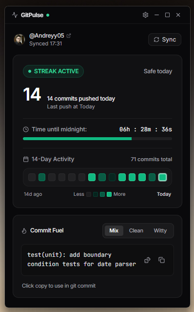
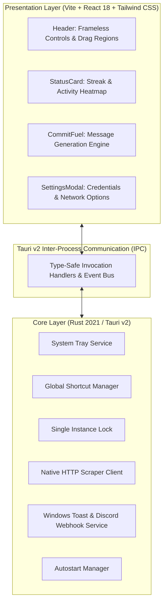

# ⚡ GitPulse (Rust Edition)

A lightweight, high-performance desktop utility designed for tracking daily GitHub contribution activity, monitoring commit streaks, and generating standardized commit messages.

Built with **Tauri v2**, **Rust**, **React 18**, and **Tailwind CSS**.

<div align="center">
  <br />
  
  <p><em>GitPulse interface showing active streak, 14-day heatmap, and Commit Fuel generator.</em></p>
  <br />
</div>

<div align="center">

[](https://www.rust-lang.org/)
[](https://v2.tauri.app/)
[](https://react.dev/)
[](https://tailwindcss.com/)
[](https://www.microsoft.com/windows)
[](LICENSE)

</div>

---

## 📋 Overview

GitPulse provides continuous real-time observability of GitHub contribution patterns directly from the Windows desktop. Engineered as a high-efficiency alternative to traditional Chromium-based desktop frameworks, GitPulse pairs a native Rust application core with an isolated web presentation layer (WebView2), drastically minimizing runtime overhead while maintaining rich user interface capabilities.

The application operates unobtrusively within the system tray, provides global keyboard shortcut accessibility, persists local state, and interfaces directly with GitHub endpoints via native HTTP bindings to prevent client-side cross-origin limitations.

---

## ⚡ Technical Specifications & Benchmarks

The following comparative evaluation highlights key resource metrics between the legacy Electron architecture and the current Tauri v2 (Rust) implementation under identical runtime conditions on Windows 11 (x86_64).

| Metric | Legacy Architecture (Electron) | Current Architecture (Tauri v2 / Rust) | Delta |
| :--- | :--- | :--- | :--- |
| **Runtime Engine** | Bundled Chromium + Node.js | Native Win32 WebView2 + Rust | Eliminates bundled browser runtime |
| **Idle Memory Consumption (RSS)** | ~180 MB – 260 MB | **~30 MB – 45 MB** | **~80% memory reduction** |
| **Cold Startup Latency** | ~2,500 – 3,500 ms | **< 250 ms** | **10x faster execution** |
| **Process Count** | 4 – 5 concurrent processes | **1 parent process + WebView workers** | Streamlined process hierarchy |
| **Asset Delivery Model** | Node.js internal HTTP/file server | **Embedded within executable (`custom-protocol`)** | Zero open network ports required |
| **Binary Portability** | Directory structure / unpacked runtime | **Standalone single PE executable** | Self-contained deployment |

---

## 📊 Key Capabilities

### Real-Time Contribution Tracking
* Tracks daily commit completion status against local midnight deadlines.
* Displays dynamic countdown timer to streak expiration in the active system timezone.
* Calculates active streak lengths and historically observed streak records.

### 14-Day Activity Heatmap
* Renders a chronological 14-day contribution density matrix matching GitHub's official activity grading scale.
* Utilizes a native backend HTTP client (`reqwest`) to fetch user contribution profiles, eliminating Cross-Origin Resource Sharing (CORS) and Content Security Policy (CSP) constraints.

### ⛽ Commit Fuel Generator
* Integrated commit message authoring tool providing instant generation of:
  * **Conventional Commits** adhering to standard specifications (`feat:`, `fix:`, `refactor:`, `chore:`, `perf:`, `docs:`, `test:`).
  * Context-aware informal commit messages for personal and exploratory development.
* Single-click clipboard dispatch with immediate visual confirmation.

### 🖥️ Native System Integration
* **System Tray Implementation:** Complete lifecycle execution from the system notification area, including context menus for manual refresh and process termination.
* **Global Visibility Accelerator:** System-wide hotkey (`CommandOrControl + Shift + G`) enabling instantaneous window toggle from any foreground application.
* **Single Instance Lock:** Mutex-based single instance enforcement that automatically redirects focus to the active process upon secondary execution attempts.
* **Desktop & Webhook Notifications:** Native Windows notifications coupled with configurable external Discord webhook dispatches for scheduled status updates.
* **Autostart Facility:** Built-in capability to register as a Windows startup application.

---

## 🏗️ Architectural Design



---

## 🧩 Technology Stack

### Backend Core
* **Language:** Rust (2021 Edition)
* **Application Framework:** Tauri v2
* **HTTP Client:** `reqwest` v0.12 (Native TLS / JSON deserialization)
* **Serialization:** `serde`, `serde_json`
* **Plugins:**
  * `tauri-plugin-single-instance`
  * `tauri-plugin-global-shortcut`
  * `tauri-plugin-autostart`
  * `tauri-plugin-notification`
  * `tauri-plugin-opener`

### Presentation Layer
* **UI Framework:** React 18
* **Build Tooling:** Vite 6
* **Styling System:** Tailwind CSS 3
* **Iconography:** Lucide React
* **Visual Effects:** Canvas Confetti

---

## ⌨️ Keyboard Controls and Navigation

| Action | Control Sequence |
| :--- | :--- |
| **Toggle Window Visibility** | `Ctrl + Shift + G` (Global) |
| **Reposition Window** | Click and drag along the top navigation bar |
| **Minimize to Tray** | Close button (`✕`) or `Ctrl + Shift + G` |
| **Restore from Tray** | Left-click tray icon or Context Menu -> `Open GitPulse` |
| **Manual Refresh** | Context Menu -> `Refresh Activity Now` |

---

## 🚀 Installation and Build Instructions

### Prerequisites

* **Node.js:** v18.0.0 or higher
* **npm:** v9.0.0 or higher
* **Rust Toolchain:** `stable-x86_64-pc-windows-gnu` or `stable-x86_64-pc-windows-msvc` (Rust 1.78+)
* **WebView2 Runtime:** Installed by default on Windows 10 (1803+) and Windows 11

### Setup

1. Clone repository:
   ```bash
   git clone https://github.com/Andreyy05/GitPulse_Rust.git
   cd GitPulse_Rust
   ```

2. Install presentation dependencies:
   ```bash
   npm install
   ```

3. Launch in development mode:
   ```bash
   npm run dev
   ```

4. Build standalone production binary:
   ```bash
   npm run build:release
   ```

The compiled, release-optimized executable will be output to:
```
src-tauri/target/release/gitpulse.exe
```

---

## ⚙️ Configuration Settings

Configuration options are managed through the settings interface and persisted via local storage:

* **GitHub Username:** Target GitHub account handle for activity aggregation.
* **Personal Access Token (PAT):** Optional GitHub token supporting `read:user` and `repo` scopes for private contribution tracking and enhanced API rate quotas.
* **Polling Interval:** Automated background sync cadence (15, 30, or 60 minutes).
* **Discord Webhook URL:** Webhook endpoint for automated status delivery to Discord servers.
* **Launch on Startup:** Toggles system startup persistence.

---

## 📄 License

Distributed under the MIT License. See [LICENSE](LICENSE) for full legal text.

---

<div align="center">
  Author: <b>Andrej Pavliščak</b> (<a href="https://github.com/Andreyy05">@Andreyy05</a>)
</div>
